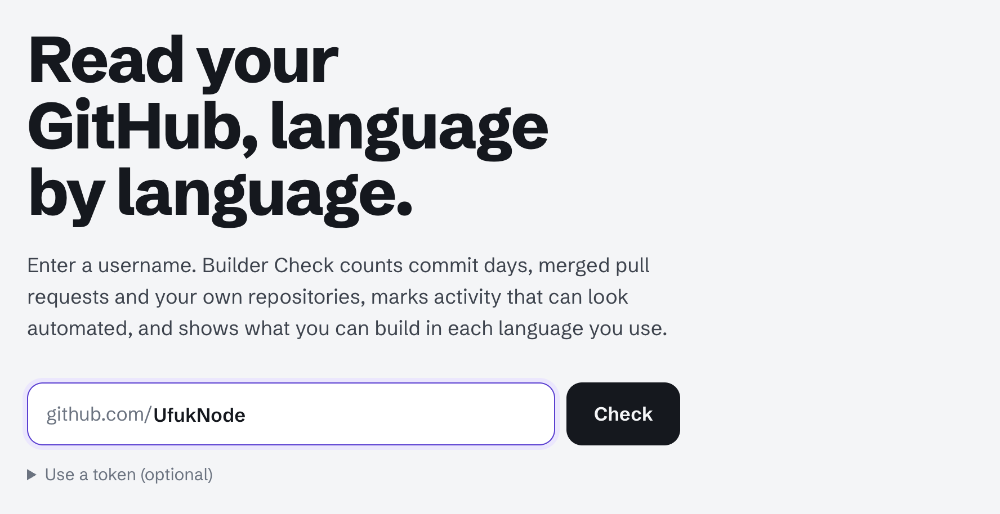
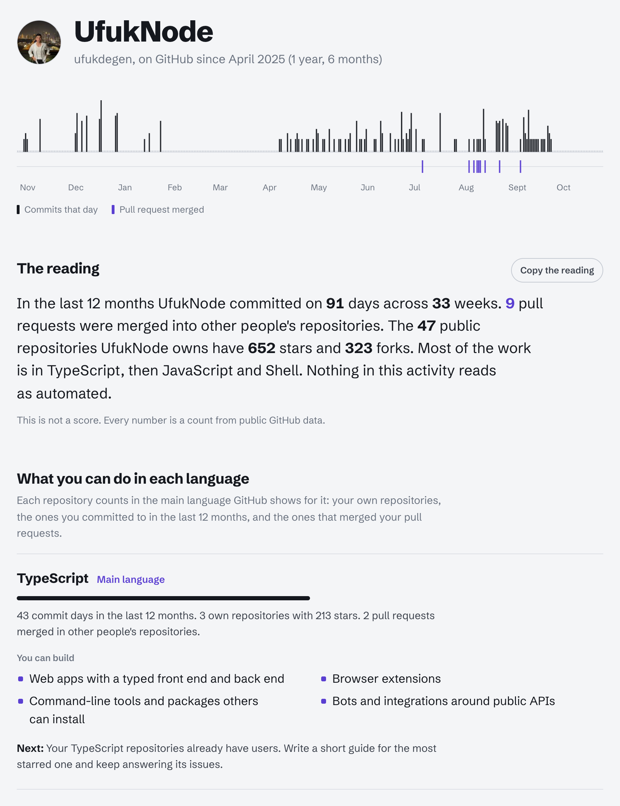
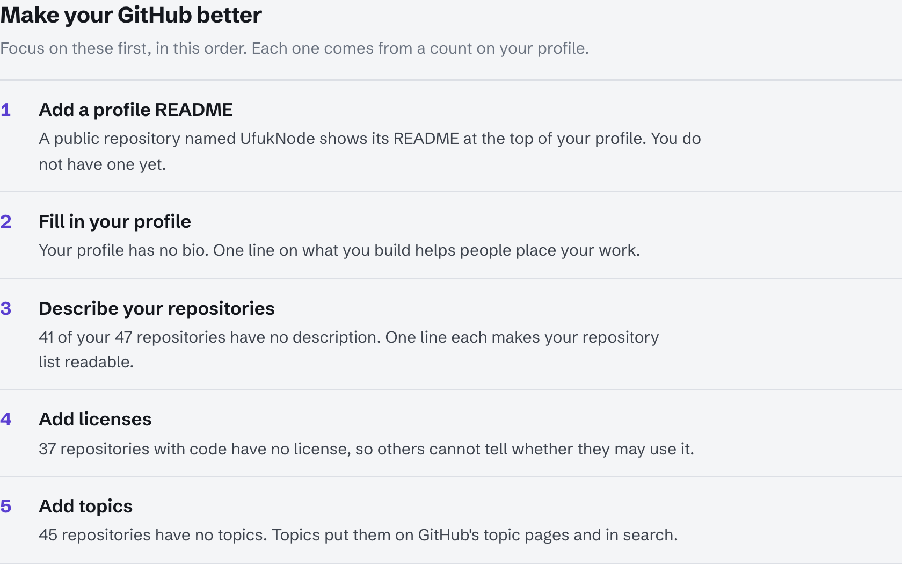
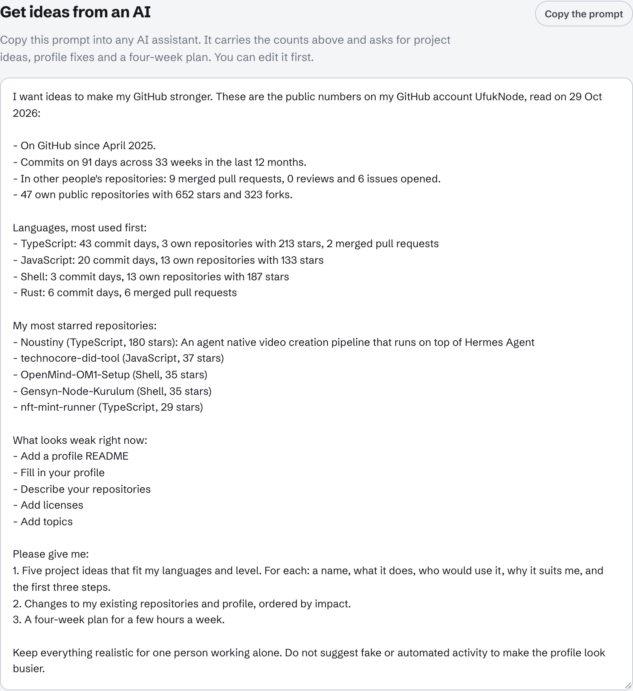

# Builder Check

Read any GitHub account as plain counts: commit days, merged pull requests, own repositories and the languages behind them. At the end it lists what to fix first and writes a prompt you can give to an AI for ideas.

> [!NOTE]
> Builder Check is not a score. Every number is a real count from the public GitHub API, with the period it covers. It reads public data only and saves nothing.

---

## 1. Start It in Codespaces

1. On this repository's page, click **Code**, open the **Codespaces** tab and click **Create codespace on main**. You can also open https://codespaces.new/UfukNode/builder-check directly.
2. When the terminal is ready, run:

```bash
npm start
```


3. Builder Check opens in a new browser tab. If it does not, click the address after `Open it from Codespaces`, or open the **Ports** tab and click the globe icon next to port 5173.

---

## 2. Enter a GitHub Username

Type a GitHub username in the empty box and click **Check**. A profile link such as `github.com/UfukNode` works too.



A check takes a few seconds. Without a token GitHub allows 10 searches a minute, so a busy account can make the page wait; it says so and continues by itself. To skip the wait, open **Use a token (optional)** and paste a [fine-grained token](https://github.com/settings/personal-access-tokens/new) with no extra permissions. It stays in the tab's memory only.

The page opens in English. The **TR** button at the top switches it to Turkish.

---

## 3. Read the Result



- **Year strip:** a mark for each day with commits in the last 12 months, merged pull requests underneath.
- **The reading:** commit days, merged pull requests, stars and forks, and the languages most of the work is in.
- **What you can do in each language:** the counts for each language, what you can build with it, and one next step.
- Below that: merged pull requests with each repository's language, your own repositories, and activity that can read as automated.

---

## 4. Find Your Weak Spots and Ask an AI

At the bottom, **Make your GitHub better** lists up to five things to fix first, each from a count on the profile.



Under it, **Get ideas from an AI** writes a prompt with your own numbers, languages, most starred repositories and weak spots. Click **Copy the prompt** and paste it into any AI assistant: it answers with project ideas that fit you, the fixes to make first and a four-week plan. You can edit the prompt before copying.



---

## Run Locally:

### Windows:

- First, follow my WSL installation guide: https://x.com/UfukDegen/status/1944066889346429338
- After completing the WSL setup, run the commands below.

### macOS:

- Run the commands below in Terminal.

```bash
git clone https://github.com/UfukNode/builder-check.git
cd builder-check
npm start
```

- Open the URL printed after:

```text
Builder Check running at http://127.0.0.1:5173
```

If 5173 is busy, the server tries 5174, 5175 and so on. There is nothing to install: the app has no dependencies.

---

## Security Model

- No backend: the small local server only serves the files in this folder
- No database, no analytics, no external scripts
- Reads public data only, from `api.github.com`
- No GitHub login or OAuth permissions
- The optional token stays in the tab's memory and is sent only to `api.github.com`

## License

MIT. Schibsted Grotesk is under the SIL Open Font License (`assets/fonts/OFL.txt`).
