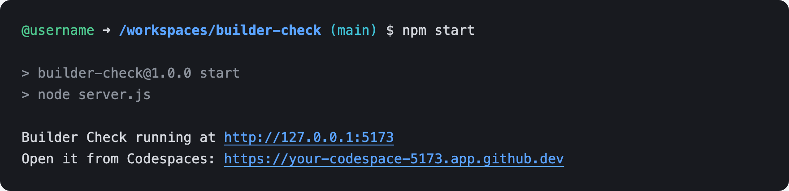
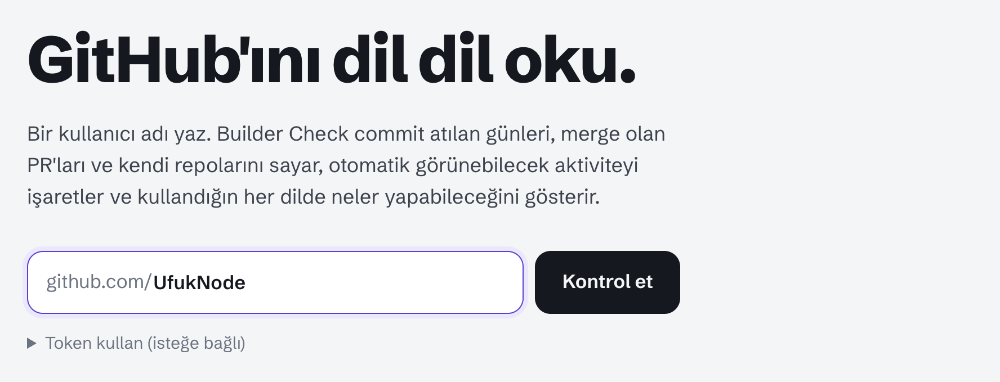
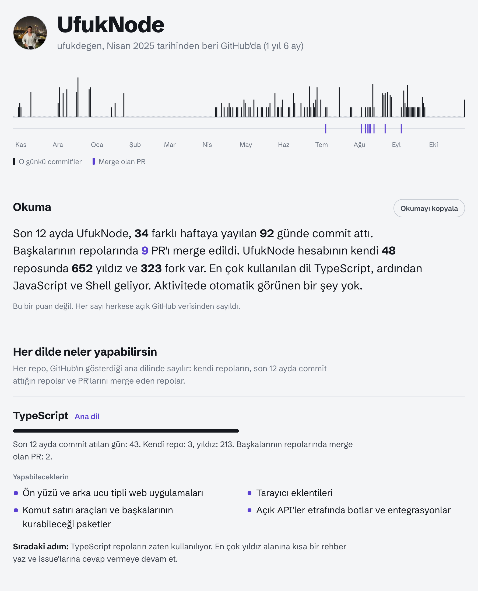
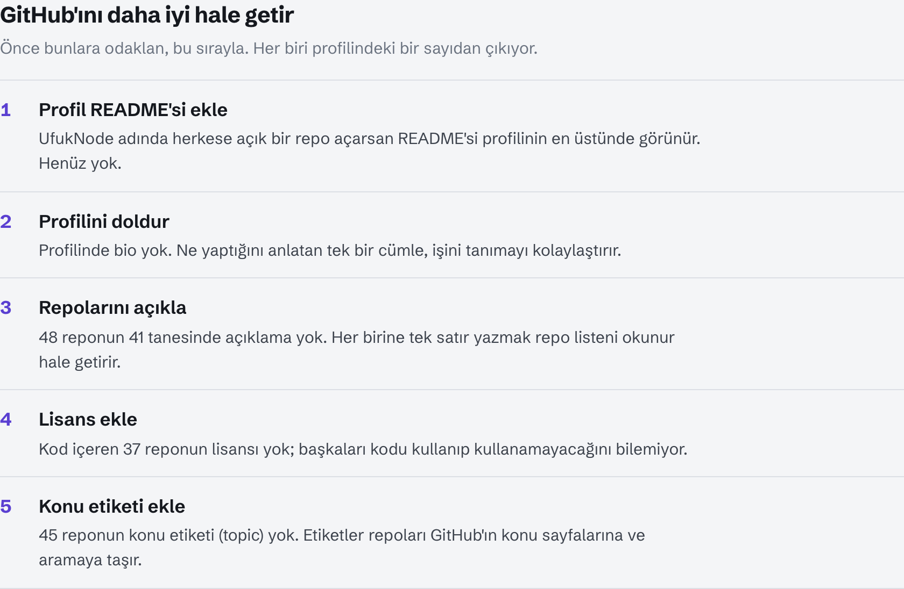
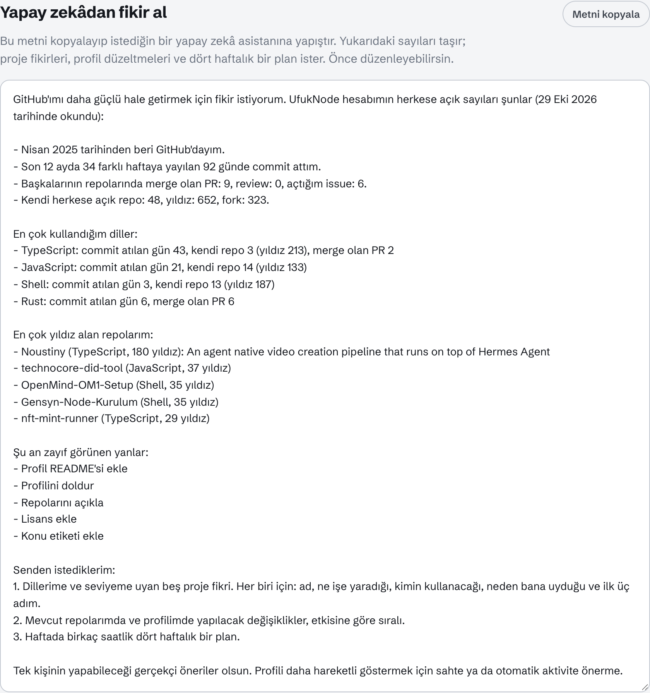
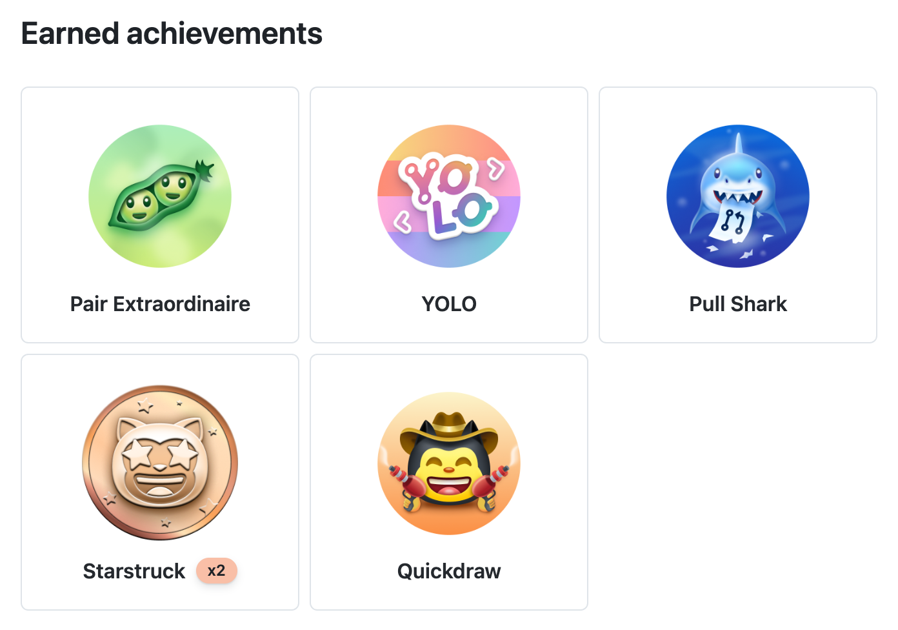

# Builder Check

**Türkçe** | [English](README.md)

Herhangi bir GitHub hesabını sade sayılarla okur: commit atılan günler, merge olan PR'lar, hesabın kendi repoları ve bunların arkasındaki diller. Sonunda önce neyi düzeltmen gerektiğini listeler ve fikir almak için bir yapay zekâya verebileceğin bir metin yazar.

> [!NOTE]
> Builder Check puan vermez. Her sayı, herkese açık GitHub API'sinden gelen gerçek bir sayımdır ve hangi dönemi kapsadığı yanında yazar. Sadece herkese açık veriyi okur ve hiçbir şey kaydetmez.

---

## 1. Codespaces'te Başlat

1. Bu reponun sayfasında **Code** düğmesine tıkla, **Codespaces** sekmesini aç ve **Create codespace on main** düğmesine tıkla. İstersen doğrudan https://codespaces.new/UfukNode/builder-check adresini de açabilirsin.
2. Terminal hazır olunca şu komutu çalıştır:

```bash
npm start
```



3. Builder Check yeni bir tarayıcı sekmesinde açılır. Açılmazsa `Open it from Codespaces` satırındaki adrese tıkla ya da **Ports** sekmesini açıp 5173 portunun yanındaki küre simgesine tıkla.

---

## 2. GitHub Kullanıcı Adını Yaz

Sayfa İngilizce açılır. Üstteki **TR** düğmesine basınca Türkçeye geçer.

Boş kutuya bir GitHub kullanıcı adı yaz ve **Kontrol et** düğmesine tıkla. `github.com/UfukNode` gibi bir profil linki de olur.



Kontrol birkaç saniye sürer. Token olmadan GitHub dakikada 10 aramaya izin verir, bu yüzden çok aktif bir hesapta sayfa biraz bekleyebilir. Beklediğini yazar ve kendisi devam eder. Beklemek istemezsen **Token kullan (isteğe bağlı)** kısmını aç ve ek izni olmayan bir [fine-grained token](https://github.com/settings/personal-access-tokens/new) yapıştır. Token sadece o sekmenin belleğinde durur.

---

## 3. Sonucu Oku



- **Yıl şeridi:** son 12 ayda commit atılan her gün için bir çizgi, altında merge olan PR'lar.
- **Okuma:** commit atılan günler, merge olan PR'lar, yıldızlar ve fork'lar, işin çoğunun yapıldığı diller.
- **Her dilde neler yapabilirsin:** her dilin sayıları, o dille neler yapabileceğin ve bir sonraki adım.
- Altında: her reponun diliyle birlikte merge olan PR'lar, hesabın kendi repoları ve otomatik görünebilecek aktiviteler.

---

## 4. Zayıf Yanlarını Bul ve Yapay Zekâya Sor

En alttaki **GitHub'ını daha iyi hale getir** kısmı, önce düzeltmen gereken en fazla beş şeyi listeler. Her biri profilindeki bir sayıdan çıkar.



Altındaki **Yapay zekâdan fikir al** kısmı, senin sayıların, dillerin, en çok yıldız alan repoların ve zayıf yanlarınla bir metin hazırlar. **Metni kopyala** düğmesine tıkla ve istediğin bir yapay zekâ asistanına yapıştır: sana uyan proje fikirlerini, önce yapman gereken düzeltmeleri ve dört haftalık bir plan verir. Kopyalamadan önce metni düzenleyebilirsin.



---

## 5. Ücretsiz GitHub Rozetlerini Al

GitHub, profilindeki **Achievements** kısmında rozetleri gösterir. Bu beşi ücretsiz ve benim profilimdeki rozetler:



| Rozet | Nasıl alınır | Seviye başına sayı |
| --- | --- | --- |
| **Quickdraw** | Bir issue ya da PR'ı açtıktan sonra 5 dakika içinde kapat. | 1 |
| **YOLO** | Bir PR'ı review olmadan merge et. Kendi repondaki kendi PR'ın da olur. | 1 |
| **Pull Shark** | Açtığın PR'lar merge olsun. Rozet, merge olan 2. PR'ında gelir. | 2, 16, 128, 1024 |
| **Pair Extraordinaire** | Bir arkadaşınla birlikte yazdığın (co-author) bir commit'i içeren PR merge olsun. | 1, 10, 24, 48 |
| **Starstruck** | Oluşturduğun bir repo 16 yıldıza ulaşsın. | 16, 128, 512, 4096 |

Rozetin yanındaki **x2**, ikinci seviye demektir.

İlk dördünü adım adım almak için bu metni kopyala, `KULLANICI_ADIN` yerine kendi kullanıcı adını yaz ve istediğin bir yapay zekâ asistanına yapıştır:

```text
GitHub kullanıcı adım KULLANICI_ADIN.
github.com üzerinde şu ücretsiz GitHub rozetlerini almamda bana tek tek yol göster:
Quickdraw, YOLO, Pull Shark ve Pair Extraordinaire.
Bunun için badge-practice adında yeni ve herkese açık bir repo kullanalım.
Her rozet için tıklanacak düğmeleri tam adlarıyla yazan kısa ve numaralı adımlar ver,
sonra bir sonrakine geçmeden önce "tamam" yazmamı bekle.
En sonda, gerçek repolarımdan birini insanların yıldız vereceği kadar faydalı hale getirmek için
(Starstruck için) kimseden yıldız istemeden uygulayabileceğim üç yol söyle.
```

---

## Bilgisayarında Çalıştır:

### Windows:

- Önce WSL kurulum rehberimi takip et: https://x.com/UfukDegen/status/1944066889346429338
- WSL kurulumunu bitirdikten sonra aşağıdaki komutları çalıştır.

### macOS:

- Aşağıdaki komutları Terminal'de çalıştır.

```bash
git clone https://github.com/UfukNode/builder-check.git
cd builder-check
npm start
```

- Şu satırdan sonra yazan adresi aç:

```text
Builder Check running at http://127.0.0.1:5173
```

5173 doluysa sunucu sırayla 5174, 5175 ve sonrasını dener. Kurulacak bir şey yok: uygulamanın hiçbir bağımlılığı yok.

---

## Güvenlik

- Backend yok: küçük yerel sunucu sadece bu klasördeki uygulama dosyalarını sunar
- Veritabanı, analiz aracı ya da dış script yok
- Sadece herkese açık veriyi `api.github.com` üzerinden okur
- GitHub girişi ya da OAuth izni istemez
- İsteğe bağlı token sadece sekmenin belleğinde durur ve yalnızca `api.github.com` adresine gönderilir

## Lisans

MIT. Schibsted Grotesk yazı tipi SIL Open Font License altındadır (`assets/fonts/OFL.txt`).
